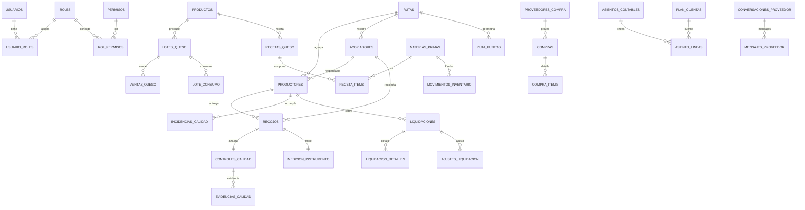

# Estructura de Base de Datos — Huata Lácteos

- **Motor:** PostgreSQL 17
- **Esquema:** `public`
- **Gestión de esquema:** Flyway, con un único SQL de inicialización: `huata/src/main/resources/db/migration/B46__esquema_consolidado.sql`.
- **Total de tablas:** **58**
- **Origen:** el esquema inicial se generó con `pg_dump --schema-only` a partir de las entidades JPA. El SQL consolidado conserva las 42 migraciones históricas, desde `V1` hasta `V46`, en orden numérico y con sus sentencias originales. **No se usa `ddl-auto` para modificar el esquema**: al arrancar, `ddl-auto=validate` comprueba que el mapeo JPA y la base coinciden.

---

## 1. Convenciones transversales

Casi todas las tablas heredan de `BaseEntity` y llevan el bloque de auditoría:

| Columna | Tipo | Notas |
|---|---|---|
| `id` | `bigint` identity | PK, `GENERATED BY DEFAULT AS IDENTITY` |
| `activo` | `boolean NOT NULL` | borrado lógico (los registros de negocio no se borran físicamente) |
| `created_at` / `updated_at` | `timestamp(6) with time zone` | |
| `created_by` / `updated_by` | `varchar(120)` | |

Notas de diseño recurrentes:

- **El stock no se guarda como columna.** Se calcula sobre `movimientos_inventario` (kardex único de materia prima *y* queso terminado por lote).
- **Los precios se congelan** en el documento (`ventas_queso.precio_unitario`, `lote_consumo.costo_unitario_momento`, `ventas_queso.monto_igv`) para poder reimprimir un comprobante viejo aunque la tarifa cambie.
- **Tarifas y recetas están versionadas por fecha** (`vigente_desde` / `vigente_hasta`): nunca se edita en sitio, se inserta una versión nueva.
- **El kardex y las ventas nunca se editan ni se borran**: una anulación inserta un movimiento/asiento compensatorio.

---

## 2. Mapa de módulos

---

## 3. Módulos y tablas

### 3.1 Seguridad, usuarios y permisos

| Tabla | Migración | Descripción |
|---|---|---|
| `usuarios` | V1 | Cuentas. `username` UNIQUE, `password` (BCrypt), `nombre_completo`, `email`, `telefono`. |
| `roles` | V1 / V8 / V25 | Catálogo cerrado de **6 roles**: `ADMINISTRADOR`, `ACOPIADOR`, `PROVEEDOR`, `CALIDAD`, `SECRETARIA`, `PRODUCTOR_QUESO`. |
| `usuario_roles` | V1 | Puente N:M usuario–rol (PK compuesta). |
| `permisos` | V8 | Catálogo de permisos por recurso/acción (`panel.read`, `acopio.write`, `pagos.cerrar-ciclo`, `planta.recepcion`, …). `codigo` UNIQUE. |
| `rol_permisos` | V8 | Puente N:M rol–permiso (PK compuesta, FK `ON DELETE CASCADE`). Índice inverso por `permiso_id`. |
| `codigos_verificacion` | V12 / V26 | Códigos de 6 dígitos (hasheados) para operaciones sensibles. `proposito` ∈ {`PRECIOS`, `REAPERTURA_PAGO`}. Índice `(solicitante, proposito, expira_en DESC)`. |

**Autorización:** el backend usa `hasAuthority('<recurso>.<accion>')`; el menú del frontend se deriva de la misma lista de permisos que devuelve `/auth/login` y `/auth/me`.

### 3.2 Maestros de campo (padrón, rutas y geografía)

| Tabla | Migración | Columnas clave |
|---|---|---|
| `productores` | V1 / V9 / V10 / V14 / V24 | `codigo` UNIQUE, `estado` ∈ {`PENDIENTE_APROBACION`,`ACTIVO`,`EN_REVISION`,`INACTIVO`,`RETIRADO`}, `excelencia`, `ruta_id`, `usuario_id`, `acopiador_responsable_id`, `zona_principal`, `orden_en_ruta`. (Se eliminó `centro_acopio_id` en V24.) |
| `acopiadores` | V1 / V16 | `nombres`, `apellidos`, `documento_identidad`, `telefono`, `usuario_id`, `ruta_id`. |
| `rutas` | V1 | `nombre`, `zona` (texto libre), `descripcion`. |
| `ruta_puntos` | V14 | Geometría de la ruta: `secuencia`, `latitud`, `longitud`. Se reemplaza completa al editar. |
| `asignaciones_ruta` | V1 | Planificación diaria: `fecha`, `acopiador_id`, `ruta_id`, `movilidad`, `observacion`. |
| `productor_ubicaciones` | V14 | Punto de referencia del proveedor: `tipo` ∈ {`CASA`,`ACTUAL`}, `latitud`, `longitud`, `fecha`. |
| `solicitudes_cambio_zona` | V14 | `zona_actual`, `zona_solicitada`, `estado` ∈ {`PENDIENTE`,`APROBADA`,`RECHAZADA`}, `fecha_decision`, `aprobador`. |
| `zona_poligonos` | V19 | Polígono opcional por zona (texto libre). `zona` UNIQUE, `color`. |
| `zona_poligono_puntos` | V19 / V20 | Vértices ordenados del polígono. V20 carga los 4 polígonos reales (COLLANA I, COLLANA II, FAON, YASIN). |
| `puntos_establecidos` | V43 | Puntos de referencia definidos a mano en el mapa: `nombre`, `latitud`, `longitud`, `ruta_id`, `acopiador_id`, `proveedor_id`. |

### 3.3 Recojo, calidad y trazabilidad de ruta

| Tabla | Migración | Columnas clave |
|---|---|---|
| `recojos` | V1 / V5–V7 / V14 / V28 / V29 / V43 | `litros`, `litros_app_movil`, `numero_envases`, `temperatura`, `capacidad_referencial`, `fuente` ∈ {`PLANTA`,`RUTA`}, `estado` ∈ {`DRAFT`,`SAVED_OFFLINE`,`PENDING_SYNC`,`SYNCED`,`CANCELLED`}, `client_uuid` UNIQUE, `estado_visita` ∈ {`ACOPIADO`,`NO_ENTREGADO`}, `motivo_no_entrega`, GPS (`latitud`,`longitud`,`distancia_proveedor_m`,`gps_fuera_de_rango`,`distancia_punto_establecido_m`), corrección (`observado`,`motivo_observacion`). |
| `controles_calidad` | V1 | Dictamen humano: `resultado` ∈ {`ACEPTADA`,`OBSERVADA`,`RECHAZADA`}, fisicoquímicos (`densidad`, `grasa`, `acidez`, `punto_congelacion`, sólidos…), organolépticos (`olor`, `aspecto`, `lugol`, `agua_anadida`), `recojo_id` UNIQUE. |
| `medicion_instrumento` | V7 | Ticket del analizador (LACTOMAT/SmartScan): `analizador_sn`, `modo`, `medido_en`, 11 variables (grasa, proteína, lactosa, sales, pH, agua añadida %, punto de congelación…). `recojo_id` UNIQUE. |
| `evidencias_calidad` | V1 / V42 | Fotos/firmas/vouchers: `tipo` ∈ {`FOTO`,`FIRMA`,`VOUCHER`,`OTRO`}, `estado` ∈ {`PENDING_UPLOAD`,`UPLOADED`,`FAILED`}, `url_archivo`, `clave_archivo` (MinIO/S3), `sha256`, OCR (`texto_ocr`, `valores_ocr`, `confianza_ocr`), `client_uuid` UNIQUE parcial. |
| `incidencias_calidad` | V1 | `tipo`, `estado` ∈ {`ABIERTA`,`EN_SEGUIMIENTO`,`CERRADA`}, `descripcion`, `productor_id`, `recojo_id`. |
| `ubicaciones_gps` | V1 / V36 | Rastreo del acopiador: `latitud`, `longitud`, `precision_metros`, `velocidad_ms`, `fecha`. Índice `(acopiador_id, fecha)`. |
| `conciliaciones_ruta` | V14 | Litros recibidos en planta por ruta/fecha. `litros_recibidos_planta`, UNIQUE `(fecha, ruta_id)`. |
| `cierres_acopio` | V1 | Cierre diario de planta: `fecha` UNIQUE, `litros_planta`, `litros_sistema`, `cerrado`, `version`. |
| `trazados_acopiador` | V27 / V41 | Recorrido dibujado por el acopiador. `tipo` ∈ {`DIA`,`PREDETERMINADO`} (CHECK: DIA exige `fecha`, PREDETERMINADO no). Índices únicos parciales. |
| `trazado_acopiador_puntos` | V27 / V41 | Vértices ordenados del trazado. |

### 3.4 Liquidación y pagos a proveedores

| Tabla | Migración | Columnas clave |
|---|---|---|
| `liquidaciones` | V1 / V3 / V4 | `periodo_inicio`, `periodo_fin`, `litros_totales`, `monto_total`, `ajustes_total`, `monto_neto`, `estado` ∈ {`DRAFT`,`CALCULATED`,`REVIEWED`,`CLOSED`}. Índice único parcial `(productor_id, periodo_inicio, periodo_fin) WHERE activo`. |
| `liquidacion_detalles` | V1 | `litros`, `precio_aplicado`, `subtotal`, `liquidacion_id`, `recojo_id`. |
| `ajustes_liquidacion` | V3 | `tipo` ∈ {`DESCUENTO_QUESO`,`PENALIDAD`,`ADELANTO`,`BONIFICACION`}, `monto` ≥ 0 (el signo lo pone el tipo). |
| `tarifas_leche` | V1 / V10 | `precio_normal`, `precio_observada`, `precio_excelencia`, `vigente_desde`, `vigente_hasta`. |

Ciclo de pago: jueves–miércoles. `CLOSED` es terminal; reabrir un pago exige el permiso `pagos.reabrir` + código de verificación (V26).

### 3.5 Producción, productos y ventas

| Tabla | Migración | Columnas clave |
|---|---|---|
| `productos` | V34 | Catálogo dinámico (reemplaza al enum `TipoQueso`): `nombre` UNIQUE (+ índice `lower(nombre)`), `unidad_venta`, `vida_util_dias`. |
| `lotes_queso` | V11 / V13 / V21 / V22 / V33 / V34 | `codigo` UNIQUE, `fecha`, `litros_destinados`, `unidades_producidas`, `origen_leche` ∈ {`ACOPIO_DEL_DIA`,`STOCK_CAMARA`}, `producto_id`, `receta_id`, `cantidad_objetivo`, costos (`costo_materia_prima`, `costo_mano_obra`, `costo_total`, `costo_unitario`), merma (`quesos_reparados`, `quesos_recorte`, `recorte_kg`), `fecha_vencimiento`. |
| `ventas_queso` | V11 / V21 | `lote_id`, `fecha`, `unidades`, `precio_unitario` (congelado), `monto_igv` (congelado), `tipo_comprador` ∈ {`PUBLICO_GENERAL`,`MAYORISTA`,`PROVEEDOR`}, `condicion` ∈ {`CONTADO`,`CREDITO_7D`}, `medio_cobro` ∈ {`EFECTIVO`,`TRANSFERENCIA`,`YAPE_PLIN`}, `estado` ∈ {`COBRADO`,`POR_COBRAR`}, `motivo_anulacion`. |
| `tarifas_queso` | V11 / V34 | Lista de precios **por producto**: `precio_publico_general`, `precio_mayorista`, `precio_proveedor`, `vigente_desde/hasta`, `producto_id`. |
| `quesos` | V1 | **Legacy.** Fila plana (fecha, fuente, producidos_kg, vendidos_kg…). Se conserva por compatibilidad con exportador y línea de tiempo; el modelo nuevo es lote + venta. |
| `recetas_queso` | V13 / V34 | Receta/BOM versionada por fecha, por producto: `producto_id`, `vigente_desde/hasta`, `rendimiento_litros_por_unidad`. |
| `receta_items` | V13 | `receta_id`, `materia_prima_id`, `cantidad_por_unidad`. |
| `lote_consumo` | V13 | Consumo real de materia prima en un lote: `cantidad_consumida`, `costo_unitario_momento` (congelado). |
| `lote_mano_obra` | V13 | Mano de obra del lote: `trabajador_produccion_id`, `monto`. |
| `trabajadores_produccion` | V13 | Maestro de personas que participan en producción (distinto de usuarios/acopiadores). |

### 3.6 Compras e inventario (kardex)

| Tabla | Migración | Columnas clave |
|---|---|---|
| `materias_primas` | V13 / V37 | `nombre` UNIQUE, `unidad_medida` ∈ {`KG`,`LITRO`,`UNIDAD`,`GRAMO`,`ML`}, `costo_unitario_referencial`, `leche_acopio` (índice único parcial: una sola "leche del acopio"). |
| `proveedores_compra` | V13 | Proveedores de insumos (ferretería, químicos, envases…), distintos de los productores de leche. |
| `compras` | V13 | Cabecera: `proveedor_compra_id`, `fecha`, `documento`. El total se calcula desde `compra_items`. |
| `compra_items` | V13 | `materia_prima_id`, `cantidad`, `costo_unitario`. |
| `movimientos_inventario` | V13 / V37 | **Kardex único** de materia prima y queso terminado. `tipo` ∈ {`ENTRADA_COMPRA`,`SALIDA_PRODUCCION_CONSUMO`,`ENTRADA_PRODUCCION_TERMINADO`,`SALIDA_VENTA`,`ENTRADA_ANULACION_VENTA`,`AJUSTE_ENTRADA`,`AJUSTE_SALIDA`,`ENTRADA_ACOPIO`}; `documento_origen_tipo` ∈ {`COMPRA`,`PRODUCCION`,`VENTA`,`AJUSTE`,`CONCILIACION`,`RECOJO`}. CHECK: el movimiento es de una `materia_prima_id` **o** de un `lote_queso_id`, nunca de ambos ni de ninguno. `cantidad` siempre positiva. |

### 3.7 Contabilidad (partida doble)

| Tabla | Migración | Columnas clave |
|---|---|---|
| `plan_cuentas` | V21 / V39 | Plan de cuentas PCGE: `codigo` UNIQUE, `nombre`, `tipo` ∈ {`ACTIVO`,`PASIVO`,`PATRIMONIO`,`GASTO`,`INGRESO`}. |
| `asientos_contables` | V21 / V23 / V26 / V39 | Cabecera (libro diario): `fecha`, `glosa`, `origen_tipo` ∈ {`COMPRA`,`PRODUCCION_CONSUMO`,`PRODUCCION_MANO_OBRA`,`PRODUCCION_TERMINADO`,`VENTA`,`VENTA_COSTO`,`ANULACION_VENTA`,`LIQUIDACION_PAGO`,`LIQUIDACION_REAPERTURA`,`RECEPCION_LECHE`}, `origen_id`. |
| `asiento_lineas` | V21 | Líneas debe/haber: `cuenta_id`, `debe` ≥ 0, `haber` ≥ 0. La partida doble la valida el servicio, no una constraint de fila. |

### 3.8 Mensajería proveedor ↔ planta

| Tabla | Migración | Columnas clave |
|---|---|---|
| `conversaciones_proveedor` | V40 | Un hilo permanente por proveedor: `productor_id` UNIQUE. |
| `mensajes_proveedor` | V40 / V44 | `conversacion_id`, `autor_usuario_id`, `cuerpo`, `leido_por_proveedor_at`, `leido_por_planta_at`, `entregado_a_*_at`, `client_uuid` UNIQUE parcial (idempotencia de cola offline). |

### 3.9 Configuración, notificaciones y auditoría

| Tabla | Migración | Columnas clave |
|---|---|---|
| `parametros_negocio` | V1 / V21 / V28 / V33 | Clave/valor configurable: `IGV_PORCENTAJE`, `RECOJO_DISTANCIA_MAXIMA_METROS`, `MALA_CALIDAD_DETECCIONES_RETIRO`, `LECHE_OBSERVADA_A_INVENTARIO`, `COSTO_LECHE_LITRO`, … `clave` UNIQUE. |
| `parametros_calidad` | V1 | Rangos por parámetro: `nombre`, `unidad`, `valor_min`, `valor_max`. |
| `notificaciones` | V1 | `usuario_id`, `titulo`, `mensaje`, `leida`, `entidad_tipo`, `entidad_id`. |
| `registros_auditoria` | V1 | Bitácora: `fecha`, `accion`, `entidad`, `actor`, `detalle`. La escribe `AuditoriaService`. |

---

## 4. Tablas eliminadas / deuda conocida

| Objeto | Estado | Motivo |
|---|---|---|
| `centros_acopio` | **Eliminada en V24** | Nunca se usó (0 proveedores asignados). RF-10 y el "centro de destino" de RF-12 quedan sin implementar (deuda anotada). |
| Roles `SUPERVISOR`, `OPERADOR`, `GERENCIA`, `COMPRAS`, `VENTAS` | **Eliminados en V25** | No asignables desde ninguna pantalla. Si el negocio los pide, se recrean con su matriz de permisos. |
| `quesos` | Legacy | Modelo plano anterior a lotes. Se mantiene solo por compatibilidad de lectura. |
| FKs `fk<hash>` | Deuda | Nombres generados por Hibernate, ilegibles; pendiente renombrar. |

---

## 5. Resumen de migraciones Flyway

`B46__esquema_consolidado.sql` inicializa una **base PostgreSQL nueva y vacía**. Flyway lo ejecuta como una única migración baseline en la versión `46`; los cambios posteriores deben continuar con `V47`, `V48`, etc. Los nombres `V1`…`V46` dentro del archivo identifican bloques históricos, no archivos separados.

**Bases existentes:** el archivo consolidado no reemplaza automáticamente el historial de una base que ya aplicó las migraciones originales. Al retirar esos archivos, Flyway puede rechazar la validación por migraciones faltantes. Antes de usar esta versión con una base existente, se necesita una transición planificada del historial, con respaldo y validación del esquema. No ejecutar el SQL consolidado sobre esa base ni borrar su historial para forzar el arranque. Este cambio solo modifica los archivos del proyecto; no modifica ninguna base de datos.

Para comprobar el SQL con PostgreSQL y validar las entidades JPA, ejecutar `mvnw.cmd -Dit.test=MigracionesFlywayIT verify` desde `huata/`, con Docker disponible. `mvn test` usa H2 y no ejecuta las migraciones.

La tabla siguiente resume los bloques históricos conservados en el SQL único:

| Rango | Contenido |
|---|---|
| V1–V2 | Esquema inicial (22 tablas) + catálogo base de roles |
| V3–V6 | Ajustes de liquidación, unicidad por periodo, mediciones del recojo |
| V7–V10 | Ticket del instrumento, permisos por recurso, estados y excelencia del proveedor |
| V11–V13 | Lotes/ventas de queso, códigos de verificación, producción+compras+inventario (kardex) |
| V14–V20 | Zonas, ubicaciones, app móvil, polígonos de zona (incl. datos reales) |
| V21–V26 | Contabilidad de quesería, mermas, liga de liquidaciones, eliminación de centros de acopio, 6 roles, reapertura de pagos |
| V27–V39* | Trazados por acopiador, GPS del recojo, corrección con justificación, productos dinámicos, compras, reglas de la leche, vencimientos |
| V40–V44 | Mensajería proveedores, compatibilidad de trazados, voucher en almacén de objetos, puntos establecidos, mensajería en tiempo real |
| V45–V46 | Puntos establecidos en tiempo real y accesos dinámicos por vista |

> \* Los bloques identificados como `V34`–`V39` conservan internamente los comentarios `V28`–`V33` (renumeración histórica). No había archivos `V30`–`V33` en el conjunto original.
