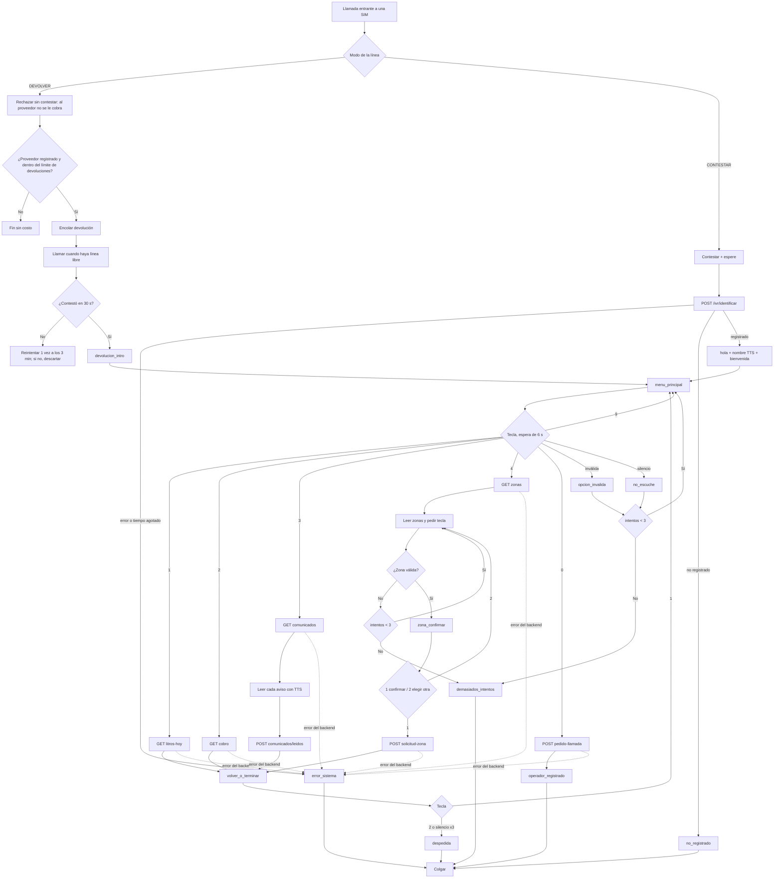

# IVR telefónico de autoatención — Huata Lácteos

**Estado:** diseño (2026-10-01). **Implementados** los endpoints del backend (sección 5, paquete `org.ramiro.huata.ivr`); falta el servicio `huata-ivr`, el hardware y los audios.
**Decisiones del cliente:** motor en Java (Asterisk 22 + ARI), equipo en la planta, 150–500 proveedores, operadoras Claro, Entel y Bitel.

Este documento cubre los 9 entregables pedidos. Los archivos de configuración están en `ivr/asterisk/` y el guion de audios en `ivr/audios/guion.csv`.

---

## 1. Verificación de Verboice y viabilidad real

| Punto | Hallazgo (octubre 2026) |
| --- | --- |
| Actividad | Último commit: 21/02/2025, y solo actualiza la integración continua. El anterior es de marzo de 2024. 257 issues abiertos. El repositorio no está archivado, pero no tiene desarrollo activo. |
| Plataforma | Ruby **2.3.4** (sin soporte desde 2019), Rails **3.2** (sin soporte desde 2016), *broker* en Erlang y MySQL 8. |
| Asterisk | Usa la imagen `instedd/verboice-asterisk`, que no se actualiza hace unos 5 años. No hay soporte documentado para Asterisk 20/22. |
| Instalación | Solo hay un `docker-compose` de **desarrollo**, con ngrok y bridges al host. No hay guía de producción vigente. |

**Conclusión: Verboice no es viable** para un servicio real. Instalarlo es montar software sin parches de seguridad que nadie mantiene, y cualquier fallo tendríamos que arreglarlo nosotros en un Rails de hace 10 años.

**Alternativa adoptada:** **Asterisk 22 LTS** (soporte completo hasta el 16/10/2028 y parches de seguridad hasta el 16/10/2029) con el driver **chan_quectel** para los módems 4G. La lógica del IVR va en un servicio **Spring Boot (Java 21)** que controla Asterisk por **ARI** (REST + WebSocket).
- Asterisk 24 LTS salió el 15/10/2026: es demasiado nuevo para chan_quectel, cuyo mínimo es Asterisk 16 y que está probado en versiones LTS anteriores. Se puede migrar más adelante.
- FreeSWITCH queda descartado porque su soporte de módems USB es peor.

### Restricciones que condicionan todo el diseño
1. **Render no puede alojar la parte telefónica.** Solo sirve HTTP/TCP: no admite el UDP de SIP/RTP ni dispositivos USB. Asterisk y los módems van en un **mini PC en la planta**; el backend se queda en Render.
2. **Render gratis se duerme** a los 15 minutos sin tráfico y tarda 30–60 s en despertar. Una persona al teléfono no espera eso. **En producción: plan Starter (US$ 7/mes)**. Como paliativo temporal, el servicio IVR hace un *ping* a `/api/v1/ivr/salud` cada 10 minutos.
3. **Apagado de 2G en Perú:** el MTC y las operadoras lo están planificando, aún sin fecha definitiva, y el 87 % de quienes usan 2G vive en zonas rurales. **No se compran equipos solo-2G** como el GoIP. Los módems elegidos son 4G con respaldo 3G/2G.
4. **Líneas a nombre de la empresa.** En 2025 se inhabilitaron más de 1,8 millones de líneas por uso ilícito, y un equipo fijo que hace muchas llamadas salientes se parece a un *SIM box*. Las SIM se registran con el RUC de la empresa (plan empresarial) y se avisa a la operadora del uso. Esto pesa sobre todo en el modo de devolución de llamada.

---

## 2. Arquitectura y hardware

```
Proveedor (celular básico)
   │  llamada a un número Claro / Entel / Bitel
   ▼
Módems USB 4G (Quectel EC25-AU o SIMCom SIM7600SA-H), 1 SIM cada uno
   │  USB (hub con fuente propia)
   ▼
Mini PC en la planta — Debian 12
   ├─ Asterisk 22 LTS + chan_quectel        (no expone SIP a internet)
   │     dialplan: toda llamada entra a Stasis(huata-ivr)
   │     ARI en 127.0.0.1:8088 (solo local)
   ├─ huata-ivr (Spring Boot, Java 21)       lógica del IVR, audios, cola de devoluciones
   │     └─ Piper TTS (local, gratuito)     voz para nombres y avisos escritos
   └─ UPS
   │  HTTPS + cabecera X-Api-Key
   ▼
Backend Huata en Render (Spring Boot) — /api/v1/ivr/**  (los mismos endpoints servirán a RapidPro)
```

### Paso a paso
1. El proveedor llama al número de una de las SIM.
2. chan_quectel entrega la llamada a Asterisk con el número de quien llama (*caller ID*).
3. El dialplan la manda a la aplicación ARI `huata-ivr`, sin lógica en el dialplan.
4. `huata-ivr` decide según el modo de la línea:
   - **contestar:** atiende la llamada;
   - **devolver:** la rechaza sin contestar y la encola para devolverla.
5. Identifica al proveedor con `POST /api/v1/ivr/identificar`.
6. Reproduce los audios pregrabados. Arma los números y las fechas a partir de fragmentos (sección 6) y genera los nombres y los avisos con Piper.
7. Cada opción del menú consulta el backend con un tiempo máximo de 4 s. Si el backend falla, reproduce un mensaje amable y cuelga.

### Por qué la lógica va en un servicio aparte y no en el backend de Render
ARI no debe exponerse a internet, así que el control de la llamada tiene que estar junto a Asterisk. Además, así el backend queda con **endpoints de datos neutrales**, que es justo lo que hará falta en la migración a RapidPro (sección 9).

### Hardware y costos (referenciales en USD, octubre 2026; cotizar en Perú)

| Ítem | Detalle | Costo aprox. |
| --- | --- | --- |
| Mini PC | Intel N100, 8 GB RAM, SSD 256 GB | 150 – 220 |
| 4 módems USB 4G | **Quectel EC25-AU** o **SIM7600SA-H**, con antenas. Deben cubrir las bandas LTE de Perú: Claro B2/B4/B7/B28, Entel B4/B28, Bitel B2/B8. **No sirve el EC25-AF**: no tiene B8 ni B28. | 60 – 90 c/u |
| Hub USB con fuente propia | 7 puertos. Los módems tienen picos de consumo al transmitir. | 25 – 40 |
| Antenas externas SMA | Solo si la señal en la planta es débil | 15 – 30 c/u |
| UPS | 800 VA | 60 – 100 |
| SIM | 1 por operadora + 1 extra de la operadora más usada | ~S/ 5 c/u |
| **Inversión inicial** | | **~US$ 500 – 750** |
| Planes de las líneas | Llamadas ilimitadas a todo destino, para el modo devolución | S/ 30 – 60 /mes por línea |
| Render Starter | Para que el backend no se duerma | US$ 7 /mes |

**Antes de comprar los 4 módems, compra uno** y prueba una llamada con una SIM de cada operadora en la planta (sección 8). Algunas operadoras no habilitan VoLTE en módulos IoT. Hoy la llamada cae a 3G y funciona, pero cuando apaguen 3G hará falta VoLTE.

### Comparación de formas de conectar la SIM

| | a) Pasarela GSM tipo GoIP | a') Pasarela 4G (Yeastar TG200/TG400 LTE) | **b) Módem USB + chan_quectel (elegida)** |
| --- | --- | --- | --- |
| Red | **Solo 2G**: riesgo por el apagado | 4G / VoLTE | 4G / VoLTE con respaldo 3G/2G |
| Conexión | SIP por red | SIP por red | USB directo |
| Llamadas simultáneas | 4 / 8 / 16 / 32 según modelo | 2 (TG200) / 4 (TG400) | **1 por módem** |
| Costo | ~US$ 150–250 (4 puertos) | ~US$ 550 (TG200) | ~US$ 60–90 por línea |
| Ventajas | Barata y madura | Equipo profesional, sin USB | El más barato por línea, con 4G |
| Desventajas | Apagado de 2G, firmware viejo, fama de inseguro | Caro | Estabilidad USB: hub alimentado, desactivar ModemManager, identificar los módems por IMEI |

---

## 3. Llamadas simultáneas

| Opción | Llamadas a la vez |
| --- | --- |
| Módem USB | **1 por módem / SIM**. En un mini PC conviene un máximo práctico de 4 a 6 módems por estabilidad USB. |
| GoIP | 4, 8, 16 o 32 según el modelo |
| Yeastar TG LTE | 2 (TG200), 4 (TG400) |

El límite lo ponen las líneas, no el mini PC: un N100 maneja decenas de llamadas.

**Dimensionamiento (Erlang B), con supuestos explícitos.** Con 500 proveedores, si el 15 % llama en la hora pico (75 llamadas) con una duración media de 90 s, el tráfico es 75 × 90 / 3600 ≈ **1,9 erlang**:
- con 2 líneas, el 38 % encuentra ocupado;
- con 3 líneas, el 20 %;
- con **4 líneas, el 8,5 %** (recomendado). En el modo devolución, cada llamada de vuelta también ocupa una línea.

Volver a medir con datos reales al mes de operación: duración media y llamadas por hora.

---

## 4. Diagrama del flujo



### Reglas de error, comunes a todos los nodos
- **Tecla inválida o silencio:** cada caso suma un intento; con 3 intentos se reproduce `demasiados_intentos` y se cuelga. El contador se reinicia al entrar a cada menú.
- **Silencio:** 6 s de espera después de terminar el audio.
- **Backend:** 4 s para conectar y 4 s para leer. Las consultas (GET) se reintentan una vez. Las escrituras (POST) no se reintentan solas: llevan `llamadaId` para que el backend no las duplique.
- **Cualquier error del backend** (5xx, tiempo agotado o sin internet) reproduce `error_sistema` y cuelga. Nunca se deja a la persona en silencio.
- **Proveedor RETIRADO o INACTIVO:** puede consultar litros, cobro y avisos, pero la opción 4 responde `zona_no_disponible`.
- **Teclas durante un audio:** se puede marcar sin esperar a que termine el menú; la tecla corta el audio.

---

## 5. Contrato de los endpoints del backend

**Base:** `https://<backend-en-render>/api/v1/ivr`.
**Autenticación:** cabecera `X-Api-Key: <clave del IVR>`. Usa el mismo patrón que `IngestaApiKeyFilter`, pero con **otra clave** (`HUATA_IVR_API_KEY`), para poder revocarlas por separado. Sin clave válida, el backend responde 401.

Principios del contrato:
- **Datos neutrales al canal:** el backend no sabe si responde a Asterisk, a RapidPro o a Twilio.
- **Cada respuesta trae un campo `texto`:** la frase lista en español sencillo, para canales con voz sintética (RapidPro/Twilio). Asterisk usa los campos estructurados y arma la frase con audios pregrabados.
- **Montos en soles con 2 decimales** y fechas ISO (`AAAA-MM-DD`) en hora de Lima.
- **Teléfono en formato E.164** (`+51` y 9 dígitos). El backend compara los **últimos 9 dígitos** del teléfono registrado en la ficha.

### 5.1 `POST /identificar`
```json
// Request
{ "telefono": "+51987654321", "canal": "ASTERISK", "llamadaId": "1696160000.12" }

// 200 — registrado
{ "encontrado": true, "proveedorId": 20, "nombre": "Alexander", "nombreCompleto": "Alexander Ccama",
  "estado": "ACTIVO", "zonaActual": "COLLANA I", "puedeSolicitarZona": true,
  "texto": "Hola, Alexander. Bienvenido a la línea de Huata Lácteos." }

// 200 — no registrado (o el número está en más de una ficha)
{ "encontrado": false, "motivo": "NO_REGISTRADO",
  "texto": "Su número no está registrado en Huata Lácteos. Acérquese a la planta o hable con su acopiador." }
```
`motivo` puede ser `NO_REGISTRADO` o `VARIOS_PROVEEDORES`. En el segundo caso hay que corregir la ficha en la planta; no se adivina cuál de los dos proveedores llama.

### 5.2 `GET /proveedores/{id}/litros-hoy`
```json
// 200
{ "fecha": "2026-10-01", "litros": 42.5, "entregas": 1, "ultimaEntrega": "06:40",
  "acopiador": "Juan Condori",
  "texto": "Hoy entregó 42 litros y medio. Lo recogió Juan Condori." }

// 200 — sin entregas
{ "fecha": "2026-10-01", "litros": 0, "entregas": 0, "texto": "Hoy todavía no tiene entregas registradas." }
```

### 5.3 `GET /proveedores/{id}/cobro`
El ciclo va de jueves a miércoles y el pago es el viernes siguiente (RN-04/RN-05). Usa `LiquidacionService.estimadoActual`.
```json
// 200
{ "cicloDesde": "2026-10-01", "cicloHasta": "2026-10-07", "litros": 295.5, "monto": 502.35,
  "moneda": "PEN", "fechaPago": "2026-10-09", "estado": "ESTIMADO",
  "ultimoCiclo": { "monto": 488.10, "fechaPago": "2026-10-02", "estado": "PAGADO" },
  "texto": "Por esta semana lleva 502 soles con 35 céntimos. Se paga el viernes 9 de octubre. Este monto puede cambiar hasta el cierre de la semana." }
```
`estado` puede ser `ESTIMADO`, `LIQUIDADO`, `PAGADO` o `SIN_ENTREGAS`.

### 5.4 `GET /proveedores/{id}/comunicados?dias=7`
Los avisos son los mensajes que la planta mandó al proveedor (Mensajería y avisos masivos) en los últimos `dias`, primero los no leídos y hasta un máximo de 5.
```json
// 200
{ "cantidad": 2,
  "comunicados": [
    { "id": 31, "fecha": "2026-09-30", "texto": "Mañana no hay recojo por feriado." },
    { "id": 33, "fecha": "2026-10-01", "texto": "El pago de esta semana será el viernes." } ],
  "texto": "Tiene 2 avisos." }
```

### 5.5 `POST /proveedores/{id}/comunicados/leidos`
```json
// Request
{ "ids": [31, 33], "llamadaId": "1696160000.12" }
// 204 sin cuerpo
```
Escucharlos por teléfono cuenta como leído: la planta ve los checks azules igual que en la app.

### 5.6 `GET /zonas`
Devuelve las zonas que tienen al menos una ruta activa, numeradas para el teclado.
```json
{ "zonas": [
    { "opcion": 1, "zona": "COLLANA I",  "audio": "zona_collana_i" },
    { "opcion": 2, "zona": "COLLANA II", "audio": "zona_collana_ii" },
    { "opcion": 3, "zona": "FAON",       "audio": "zona_faon" },
    { "opcion": 4, "zona": "YASIN",      "audio": "zona_yasin" } ] }
```

### 5.7 `POST /proveedores/{id}/solicitud-zona`
Crea la misma `SolicitudCambioZona` que la app, pendiente de aprobación en la web, con el motivo "Pedido por teléfono (IVR)". No se duplica: si ya hay un pedido pendiente **a la misma zona** (un reintento tras un corte), responde 200 con ese pedido.
```json
// Request
{ "zona": "FAON", "llamadaId": "1696160000.12" }

// 201 (o 200 si el mismo pedido ya existía)
{ "solicitudId": 12, "estado": "PENDIENTE",
  "texto": "Listo. Su pedido para pasar a FAON quedó registrado. La planta le avisará." }

// 409
{ "codigo": "YA_PENDIENTE", "texto": "Ya tiene un pedido de cambio de zona esperando respuesta." }
```
`codigo` puede ser:
- `YA_PENDIENTE`: ya hay un pedido pendiente a otra zona.
- `MISMA_ZONA`: ya está en esa zona.
- `ZONA_NO_DISPONIBLE`: la zona no tiene rutas activas.
- `NO_PERMITIDO`: solo un proveedor **ACTIVO** pide cambio de zona; uno pendiente de aprobación, en revisión o retirado consulta, pero no pide.

### 5.8 `POST /proveedores/{id}/pedido-llamada` (tecla 0)
Deja un aviso en la **campana de notificaciones** de la web: *"Pidió que lo llamen"*, con su nombre, código y teléfono, para que alguien de la planta lo llame. Es más barato y confiable que transferir la llamada, que ocuparía una segunda línea. Va a la campana y no a Mensajería porque un mensaje necesita un autor con cuenta, y muchos proveedores no tienen cuenta en la app.
```json
// Request
{ "llamadaId": "1696160000.12" }
// 201
{ "texto": "Listo. Pedimos a la planta que lo llame." }
```

### 5.9 `GET /salud`
```json
{ "estado": "OK", "hora": "2026-10-01T08:15:00-05:00" }
```
Sirve como sonda del IVR y para mantener despierto Render mientras siga en el plan gratuito.

### Errores comunes
- **401:** falta la clave o es inválida.
- **404:** el proveedor no existe.
- **422:** regla de negocio, con un `texto` que el IVR puede leer.
- **5xx:** el IVR reproduce `error_sistema` y cuelga.

---

## 6. Guion de audios

Todos los audios están en `ivr/audios/guion.csv`, con su nombre de archivo y su texto. Aquí van las reglas.

### Formato
WAV PCM **8 kHz, mono, 16 bits**. Se graba a 44,1 kHz con una voz humana local, pausada y amable, y se convierte con:

```bash
sox entrada.wav -r 8000 -c 1 -b 16 salida.wav silence 1 0.05 0.5% reverse silence 1 0.05 0.5% reverse norm -3
```
El comando quita los silencios del inicio y del final y normaliza el volumen.

### Estilo
- Frases cortas, de menos de 8 s cada una.
- Siempre "marque 1", nunca "presione la tecla numérica".
- Se trata a la persona de **usted**.
- Primero la acción y después el número: *"Para saber cuánto va a cobrar, marque 2"*. Así la persona sabe qué tecla corresponde a lo que quiere.

### Números naturales
Se arman en Java concatenando fragmentos pregrabados (`num_*.wav`):
- **Litros:** se redondean a medio litro. *"42 litros y medio"*, *"un litro"*, *"medio litro"*.
- **Soles:** *"502 soles con 35 céntimos"*, *"un sol"*, *"21 soles"* se dice *"veintiún soles"*.
- **Apócope:** *un*, *veintiún*, *treinta y un*… delante de un sustantivo masculino (litros, soles, céntimos son masculinos).
- **Centenas:** 100 se dice *"cien"*, y de 101 en adelante *"ciento…"*. **Miles:** *"mil"*, *"dos mil"*.
- **Fechas:** *"el viernes 9 de octubre"* se arma con `dia_viernes` + número + `de` + `mes_octubre`.

### Voz sintética (Piper, gratuita y local)
Se usa solo para lo que no se puede grabar de antemano: el **nombre** del proveedor y el **texto de los avisos**.
- Voz recomendada: `es_MX` (la más cercana al español peruano). Escuchar las disponibles y elegir con el cliente.
- Se guarda en caché por texto, así cada nombre o aviso se sintetiza una sola vez.

---

## 7. Instalación desde cero

Todo se instala en el mini PC con **Debian 12**, con usuario administrador y acceso SSH solo desde la red local.

### 7.1 Sistema base
```bash
sudo apt update && sudo apt -y full-upgrade
sudo apt -y install build-essential git wget curl cmake sox libsox-fmt-all alsa-utils usb-modeswitch ufw unattended-upgrades
# ModemManager "secuestra" los puertos de los módems: se desactiva.
sudo systemctl disable --now ModemManager
# Cortafuegos: nada de SIP ni ARI hacia afuera; solo SSH desde la LAN de la planta.
sudo ufw default deny incoming && sudo ufw allow from 192.168.0.0/16 to any port 22 proto tcp && sudo ufw enable
```

### 7.2 Asterisk 22 LTS
```bash
cd /usr/src
sudo wget https://downloads.asterisk.org/pub/telephony/asterisk/asterisk-22-current.tar.gz
sudo tar xzf asterisk-22-current.tar.gz && cd asterisk-22.*/
sudo contrib/scripts/install_prereq install
sudo ./configure --with-jansson-bundled --with-pjproject-bundled
sudo make menuselect.makeopts
sudo menuselect/menuselect --enable res_ari --enable res_stasis --enable app_stasis \
     --enable res_http_websocket --enable format_wav menuselect.makeopts
sudo make -j"$(nproc)" && sudo make install && sudo make config && sudo ldconfig
# Usuario sin privilegios; con acceso a audio y a los puertos serie de los módems.
sudo groupadd -r asterisk; sudo useradd -r -d /var/lib/asterisk -g asterisk asterisk
sudo usermod -aG audio,dialout asterisk
sudo sed -i 's/^#AST_USER=.*/AST_USER="asterisk"/; s/^#AST_GROUP=.*/AST_GROUP="asterisk"/' /etc/default/asterisk
sudo chown -R asterisk:asterisk /etc/asterisk /var/lib/asterisk /var/log/asterisk /var/spool/asterisk /var/run/asterisk
```

### 7.3 Driver chan_quectel
Hay dos *forks* activos: `IchthysMaranatha/asterisk-chan-quectel` (el más usado) y `RoEdAl/asterisk-chan-quectel` (empaquetado con cmake). Los pasos de compilación cambian entre forks, así que **se sigue el README del fork elegido** y se compila contra los headers del Asterisk 22 instalado en 7.2.
```bash
cd /usr/src && sudo git clone https://github.com/IchthysMaranatha/asterisk-chan-quectel.git
cd asterisk-chan-quectel   # seguir su README para compilar e instalar chan_quectel.so
sudo cp ivr/asterisk/quectel.conf /etc/asterisk/quectel.conf   # desde este repositorio; poner los IMEI reales
```
Para la voz por USB en Quectel EC25 (UAC) se activa una sola vez por módem con el comando AT que indica la guía del driver (`AT+QPCMV=1,2`) y `quec_uac=1` en `quectel.conf`.

**Probar primero con un solo módem:**
```bash
sudo asterisk -rx "quectel show devices"   # Debe aparecer cada línea Free, con su operadora y señal
```

### 7.4 Configuración de Asterisk
Copiar desde `ivr/asterisk/` a `/etc/asterisk/`:

| Archivo | Para qué |
| --- | --- |
| `http.conf` | HTTP de Asterisk solo en `127.0.0.1:8088` |
| `ari.conf` | Usuario ARI `huata-ivr`; la contraseña se genera en el equipo y no va al repositorio |
| `extensions.conf` | Toda llamada entrante va a `Stasis(huata-ivr,...)` |
| `quectel.conf` | Una sección por línea, identificada por IMEI, con su modo (`contestar`/`devolver`) |

```bash
sudo systemctl enable --now asterisk && sudo asterisk -rx "ari show apps"
```

### 7.5 Servicio huata-ivr (Spring Boot)
```bash
# Java 21 (Temurin)
sudo apt -y install wget apt-transport-https gpg
wget -qO - https://packages.adoptium.net/artifactory/api/gpg/key/public | sudo gpg --dearmor -o /usr/share/keyrings/adoptium.gpg
echo "deb [signed-by=/usr/share/keyrings/adoptium.gpg] https://packages.adoptium.net/artifactory/deb bookworm main" | sudo tee /etc/apt/sources.list.d/adoptium.list
sudo apt update && sudo apt -y install temurin-21-jre
# Usuario, carpeta y unidad systemd
sudo useradd -r -s /usr/sbin/nologin huataivr && sudo mkdir -p /opt/huata-ivr /var/lib/huata-ivr/audios
sudo cp huata-ivr.jar /opt/huata-ivr/ && sudo cp ivr/huata-ivr/application.example.yml /opt/huata-ivr/application.yml
sudo cp ivr/huata-ivr/huata-ivr.service /etc/systemd/system/ && sudo systemctl enable --now huata-ivr
```
Los secretos (`HUATA_IVR_API_KEY`, contraseña ARI) van en `/etc/huata-ivr.env` con permisos 600, **no** en el `.yml` ni en el repositorio.

Estructura propuesta del servicio:

| Clase | Responsabilidad |
| --- | --- |
| `AriClient` | WebSocket de eventos (`StasisStart`, `ChannelDtmfReceived`, `PlaybackFinished`, `StasisEnd`) y llamadas REST: `answer`, `play`, `hangup`, `originate`. Se puede usar `ari4java` 0.18 (enero 2026) o un cliente propio con `java.net.http`; para tan pocas llamadas, el cliente propio evita depender de una librería. |
| `SesionLlamada` | Máquina de estados por llamada (nodos de la sección 4), intentos y tiempos de espera. |
| `BackendClient` | `RestClient` con tiempo máximo de 4 s, `X-Api-Key` y un reintento solo en GET. |
| `Locutor` | Convierte números, montos y fechas en la lista de audios. Lleva pruebas unitarias. |
| `VozSintetica` | Llama a Piper y guarda el resultado en `/var/lib/huata-ivr/audios/tts/`. |
| `ColaDevoluciones` | Llamadas de vuelta: límite por número, reintento y línea libre. |

### 7.6 Piper TTS
```bash
sudo apt -y install python3-venv
sudo python3 -m venv /opt/piper && sudo /opt/piper/bin/pip install piper-tts
# Descargar una voz es_MX y probar (los nombres exactos de voz y del comando: ver docs de OHF-Voice/piper1-gpl)
```
El proyecto original (`rhasspy/piper`) se archivó en octubre de 2025; el mantenido es `OHF-Voice/piper1-gpl`, con licencia GPL-3.0. Se usa como **programa externo**, así que la licencia no afecta al código de Huata.

### 7.7 Cambios en el backend (Render)
- Paquete nuevo `ivr` con `IvrController` (sección 5) y `IvrApiKeyFilter`, que copia el patrón de `IngestaApiKeyFilter`, con su propia clave.
- Variable de entorno `HUATA_IVR_API_KEY` en Render.
- Reutiliza los servicios existentes:
  - `LiquidacionService.estimadoActual` para el cobro;
  - los recojos del proveedor para los litros;
  - `MensajeriaService` para los avisos;
  - `SolicitudCambioZonaService.crear` para el cambio de zona.
- Pruebas de contrato con MockMvc para cada endpoint, más una que confirme que sin clave responde 401.
- Plan **Starter** en Render.

---

## 8. Plan de pruebas y checklist de producción

### 8.1 Pruebas
1. **Unitarias (huata-ivr):**
   - `Locutor`: 0; 1; 21 litros; 21 soles; 100; 101; 1000; 0,5 litros; 502,35 soles; fechas.
   - Máquina de estados: tecla inválida x3, silencio x3, backend caído en cada nodo.
2. **Contrato (backend):** MockMvc por endpoint, más el 401 sin clave.
3. **Laboratorio con 1 módem**, antes de comprar los 4:
   - llamar desde un celular básico de **cada operadora** (Claro, Entel, Bitel);
   - medir el tiempo hasta escuchar el menú (meta: menos de 3 s);
   - confirmar que el teclado se detecta bien en cada operadora: el DTMF por la red celular es el punto más frágil;
   - escuchar el volumen de los audios;
   - verificar si la llamada va por VoLTE o 3G.
4. **Errores:**
   - apagar el backend o poner una clave inválida: debe sonar `error_sistema` en menos de 10 s;
   - desconectar el internet de la planta;
   - desenchufar y volver a enchufar un módem: la línea debe volver sola.
5. **Devolución de llamada:**
   - una llamada perdida debe producir la devolución en menos de 30 s, sin costo para quien llamó;
   - superar el límite diario: no debe haber devolución;
   - un número no registrado: no debe haber devolución.
6. **Carga:** 4 llamadas simultáneas reales, más una quinta que debe dar ocupado.
7. **Prueba de resistencia:** 8 horas con una llamada automática cada 5 minutos, sin fugas de memoria ni líneas colgadas.
8. **Piloto:** 10 proveedores reales durante 1 semana, con una encuesta corta en la planta: si entendieron el menú y la voz.

### 8.2 Checklist de puesta en producción
- [ ] SIM registradas a nombre de la empresa (RUC), con plan activo y la operadora informada del uso.
- [ ] Cada línea probada: señal, VoLTE o 3G, y DTMF.
- [ ] Teléfonos de los proveedores en formato correcto y sin duplicados (reporte desde el backend).
- [ ] Backend en el plan Starter, con `HUATA_IVR_API_KEY` configurada en Render y en el mini PC.
- [ ] ARI y HTTP de Asterisk solo en `127.0.0.1`, cortafuegos activo y ningún puerto SIP expuesto.
- [ ] Asterisk y huata-ivr se reinician solos (`systemctl enable`).
- [ ] UPS conectada y probada con un corte real.
- [ ] Audios finales grabados con voz humana y aprobados por el cliente.
- [ ] Monitoreo:
  - `/api/v1/ivr/salud` cada 5 minutos;
  - `quectel show devices` reportado al backend o enviado por correo si una línea cae;
  - rotación de logs.
- [ ] Respaldo de `/etc/asterisk`, `/opt/huata-ivr` y los audios.
- [ ] Llamada de prueba diaria automática y aviso si falla.
- [ ] Aviso en la bienvenida o en el reglamento de que se consulta por número de teléfono (privacidad).
- [ ] La publicación de datos de terceros sigue la regla de §0 de CLAUDE.md: el IVR solo da datos del propio proveedor.

---

## 9. Migración a RapidPro + Twilio

| Pieza | Se reutiliza | Qué hay que rehacer |
| --- | --- | --- |
| Endpoints `/api/v1/ivr/**` | **Sí, sin cambios.** RapidPro los llama con *Call Webhook* y la cabecera `X-Api-Key`. | Nada. Solo una clave nueva para RapidPro. |
| Campo `texto` | **Sí.** RapidPro/Twilio lo leen con voz sintética. | — |
| Audios fijos | **Sí.** Se suben a RapidPro (*Play recording*) o a una URL para Twilio. | Convertir a MP3 o WAV si el canal lo pide. |
| Números y fechas con fragmentos | Parcialmente | En RapidPro concatenar muchos audios es incómodo: se usa el `texto` con voz sintética. |
| Flujo (sección 4) | **Sí, como especificación.** | Se reconstruye en el editor de flujos de RapidPro: mismos nodos, intentos y tiempos. |
| Servicio huata-ivr (Java/ARI) | No | Lo reemplaza el flujo de RapidPro. Su lógica de estados sirve de guía. |
| Identificación por caller ID | **Sí.** RapidPro conoce el número (`@contact.urns`). | Guardar `proveedorId` en un campo del contacto tras el primer webhook. |
| Devolución de llamada | Concepto | Con Twilio la llamada saliente la paga la empresa por minuto, y RapidPro puede iniciar un flujo de voz saliente. Verificar la disponibilidad de números peruanos en Twilio (requisitos regulatorios). |
| Módems y mini PC | Opcional | Pueden quedar de respaldo o para SMS, o retirarse. |
| Plan de pruebas | **Sí** | Mismo plan, cambiando el laboratorio por llamadas a través de Twilio. |

**Para que la migración sea fácil desde hoy:**
1. **Toda regla de negocio va en el backend**, no en el IVR. Por ejemplo, quién puede pedir cambio de zona lo decide el backend con `puedeSolicitarZona`, y el IVR solo lo obedece.
2. **Los nombres de los audios son estables** (`guion.csv`), y RapidPro usará los mismos.
3. **El IVR no guarda estado propio** más allá de la llamada en curso.

---

## Preguntas abiertas (no se resuelven inventando)
- **Modo de cada línea:** cuáles contestan directamente y cuáles devuelven la llamada. Depende del costo de los planes.
- **Límite de devoluciones:** cuántas por número y por día. Propuesta: 1 cada 10 minutos y como máximo 5 al día.
- **Opción 0:** si se quiere transferencia en vivo en horario de oficina; ocupa 2 líneas. La propuesta actual deja un pedido de llamada en Mensajería.
- **PIN:** si la opción 2 (cobro) debe pedirlo. El caller ID se puede falsificar, aunque es poco probable en este contexto.
- **Voz:** quién graba los audios fijos y qué voz de Piper se usa.
